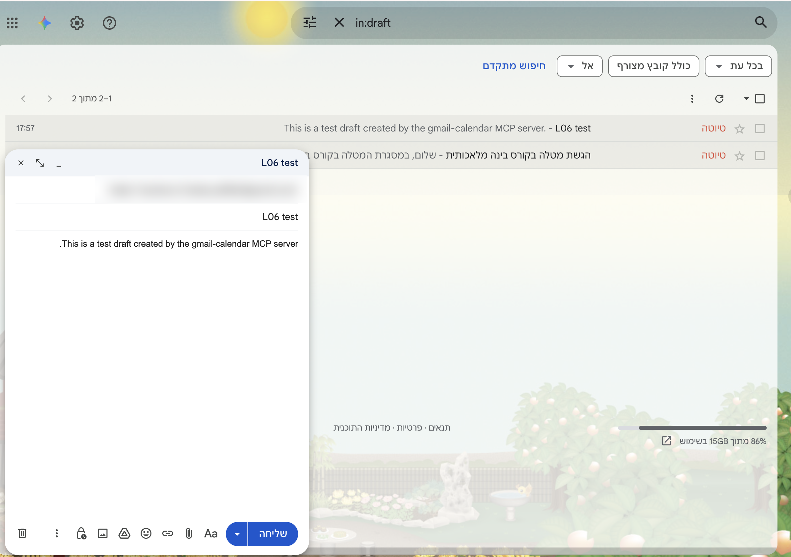
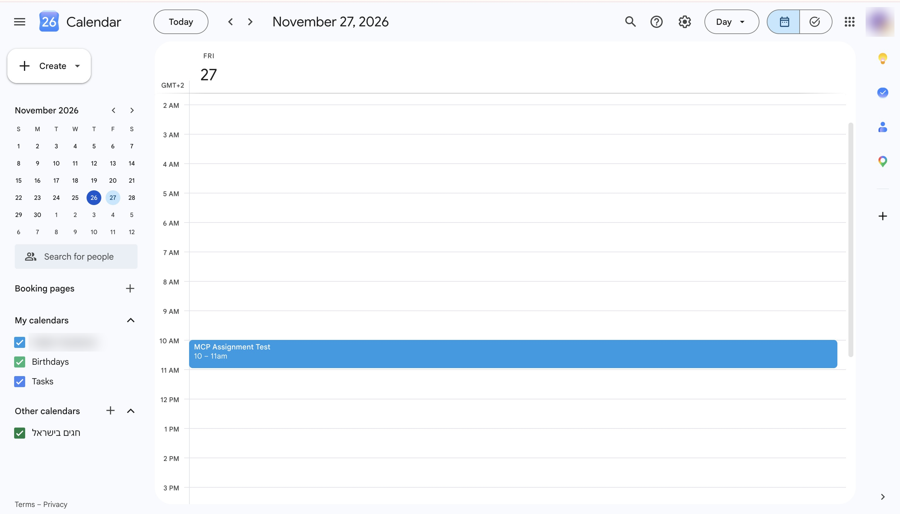

# gmail-calendar MCP Server

An MCP server built with Python, `uv`, and the official MCP Python SDK (`FastMCP`) over `stdio` transport. It exposes read-only and draft-only Gmail tools plus Google Calendar tools configured for the `Asia/Jerusalem` time zone.

## Prerequisites

1. Place your downloaded Google OAuth Desktop `client_secret*.json` file in `~/my-private`.
2. Authenticate once interactively to generate `~/my-private/token.json`:

```bash
uv run auth.py
```

The MCP server never opens a browser or copies credential files into the repository; it reads `token.json` directly from `GOOGLE_PRIVATE_DIR`.

## Running the MCP Server

Set `GOOGLE_PRIVATE_DIR` (defaults to `~/my-private` if unset) and start the server via `uv`:

```bash
GOOGLE_PRIVATE_DIR=~/my-private uv run gmail-calendar
```

You can also run it via:

```bash
GOOGLE_PRIVATE_DIR=~/my-private uv run server.py
```

### Example MCP Client Configuration

```json
{
  "mcpServers": {
    "gmail-calendar": {
      "command": "uv",
      "args": ["--directory", "/path/to/L06", "run", "gmail-calendar"],
      "env": {
        "GOOGLE_PRIVATE_DIR": "/path/to/my-private"
      }
    }
  }
}
```

## Available Tools

No tool sends emails or deletes emails/events.

1. `search_emails(query, max_results=10)` — Search Gmail messages and return metadata summaries.
2. `read_email(message_id)` — Read full headers and body of a Gmail message.
3. `create_draft(to, subject, body)` — Create a Gmail draft only (never sends).
4. `list_events(days_ahead=7)` — List upcoming primary calendar events in `Asia/Jerusalem`.
5. `find_free_slots(date, duration_minutes=30)` — Find free slots on `YYYY-MM-DD` between `08:00` and `20:00` (`Asia/Jerusalem`).
6. `create_event(title, start, end, description="")` — Create a calendar event in `Asia/Jerusalem` (accepts ISO-8601 timestamps).

## Execution Results



צילום מסך של טיוטת המייל `"L06 test"` שנוצרה ב-Gmail באמצעות הכלי `create_draft` (טיוטה בלבד, ללא שליחה).



צילום מסך של האירוע `"MCP Assignment Test"` שנוצר ב-Google Calendar לתאריך 27 בנובמבר 2026 בין השעות `10:00–11:00` (`Asia/Jerusalem`) באמצעות הכלי `create_event`.

## Prompts Used Today

1. Check the working folder and whether it is empty.
2. Check whether Google API credentials from lesson L05 (`client_secret*.json`, `token.json`) exist in the home directory without printing contents or modifying files.
3. Move the downloaded `client_secret*.json` from `~/Downloads` to `~/my-private`, create a `uv` Python OAuth authentication script (`gmail.modify` and `calendar` scopes), and run it to generate `~/my-private/token.json`.
4. Build the `gmail-calendar` MCP server in Python using `FastMCP`, `uv`, and `stdio` transport reading `GOOGLE_PRIVATE_DIR` (6 tools: `search_emails`, `read_email`, `create_draft`, `list_events`, `find_free_slots`, `create_event`; no send/delete tools; `Asia/Jerusalem` timezone; each Python file under 150 lines; `.gitignore` and `README.md`).
5. Show the file tree, a table of tools with their Google API calls, confirmation that no tool sends or deletes anything, and `.gitignore` contents.
6. Write and run `test_server.py` with `uv` to list tools and call `list_events(days_ahead=1)`.
7. Add `gmail-calendar` to `.agents/mcp_config.json` using `uv` and `GOOGLE_PRIVATE_DIR`.
8. Check what is in the calendar tomorrow.
9. Write a Gmail draft to myself (`"L06 test"`) and add a calendar event today 4 hours from now (`"MCP works"`).
10. Find a free hour tomorrow between `09:00` and `17:00` and add an event called `"Study group"`.
11. Ask to send the `"L06 test"` draft (verifying the server refuses/has no send tool).
12. Ask to delete the `"Study group"` event (verifying the server refuses/has no delete tool).
13. Initialize a Git repository, verify `git status` excludes secret files, and commit.
14. Audit all tracked files and Git history for secrets, API keys, OAuth tokens, email addresses, and personal paths.
15. Prepare the repository for public GitHub publication (portable paths in `README.md` and `test_server.py`, exclude `.agents/mcp_config.json` from Git while keeping it locally, rewrite Git history with a GitHub noreply email, and verify the MCP server).
16. Connect the local Git repository to the GitHub remote and attempt to push `main`.
17. Check whether GitHub CLI (`gh`) is installed and check `gh auth status`.
18. Create `reflection.md` with four empty sections, add the list of prompts used today to `README.md`, and commit.
